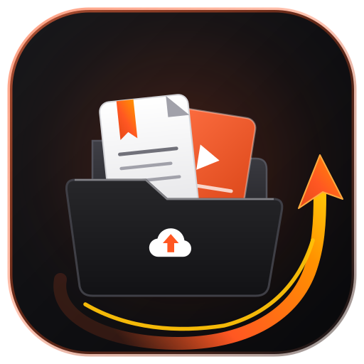

<p align="center">
  <br />
  
</p>

<h1 align="center">
  OrganizeUp
</h1>

<p align="center">
  <b>The modern personal knowledge engine & learning workspace.</b><br />
  Capture, organize, study, and master books, video courses, developer tools, audiobooks, and collaborative knowledge — all in one unified, distraction-free environment.
</p>

<p align="center">
  🚀 <b>Live Application: <a href="https://organizeup.app">https://organizeup.app</a></b>
</p>

<p align="center">
  
  
  
</p>

---

## 💡 The OrganizeUp Vision

Great learning resources are scattered everywhere: valuable PDFs shared in Telegram groups, developer tools dropped in Discord servers, course folders shared on Google Drive, and deep-dive tutorial series on YouTube. Within days, those valuable insights get lost in cluttered bookmark bars, buried chats, and forgotten folders.

**OrganizeUp transforms resource chaos into a structured learning engine:**
* **Instant Capture:** Send links, PDFs, and files from Telegram or Discord directly into your personal capture inbox with zero friction.
* **Structured Course Learning:** Import Google Drive folders while keeping the complete folder directory tree intact, with visual previews, format badges, and lecture progress tracking.
* **Habit Reminders:** Schedule review reminders on any book, lecture, or saved link that deliver directly to your phone or desktop even when the app is closed.
* **Multi-Format Reading & Playback:** Seamlessly read PDFs with reading-position memory, watch video lectures with reflection notes, and stream audiobooks with interactive audio waveforms.
* **Collaborative Study Spaces:** Build shared project hubs and study wikis with real-time multiplayer co-editing, drag-and-drop Kanban boards, interactive checklists, and code snippets.
* **Community Discovery:** Explore community-curated learning roadmaps, upvote top-tier resources, and clone public workspaces directly to your library.

---

## 🚀 Core Workflows & Everyday Applications

### 🎓 1. Interactive Courses with Google Drive Importer
Turn any shared Google Drive folder into a full-featured online learning course:
* **Directory Tree Preservation:** Automatically scan and mirror the complete folder and subfolder hierarchy. Navigate modules smoothly using collapsible dropdown trees.
* **Visual Lecture Previews:** High-resolution preview thumbnails for each file with instant visual indicators for **Videos**, **PDFs**, **Slides**, **Docs**, **Sheets**, and **Code**.
* **Video Play Overlays & Size Labels:** Instant visual cues showing video badges and human-readable file sizes.
* **Progress Tracking:** Check off completed lectures with one click to update your course progress bar and stay motivated.
* **Full-Screen Reader & Video Player:** Watch videos or read lecture documents without leaving the app.

---

### ⏰ 2. Smart Review Reminders & Device Notifications
Never let a saved article, book chapter, or course video sit forgotten:
* **One-Click Reminders:** Set a custom reminder date and time with an optional note on any saved link, book, or video.
* **Background Device Notifications:** Delivers notification alerts directly to your mobile or desktop device even if the browser or application is completely closed.
* **In-App Notification Center:** A top-bar notification bell lists upcoming and triggered reminders with unread counts and direct 1-click links to jump straight into the resource.
* **Per-Video Reminders:** Set reminders on specific lectures inside YouTube playlists or courses to pace out your study sessions.

---

### 📖 3. Universal Reading & Media Hub
OrganizeUp adapts to how you absorb knowledge across all major formats:

| Format | Workflow & Experience |
|---|---|
| 🎬 **Video Courses & Books** | Sequential chapter player with watch progress tracking. Triggers an automatic **reflection prompt** upon completion to help you record key takeaways in your notes. |
| 📄 **PDFs & Digital Books** | In-browser reader with automatic scroll-position memory that reopens to the exact page you last read. Includes full-screen distraction-free mode. |
| 🎧 **Audiobooks & Lectures** | Interactive audio player with animated sound waveforms, variable playback speed controls, and track seeking. Includes built-in access to tens of thousands of free classic audiobooks and modern summaries. |

---

### 📺 4. YouTube Playlists & Video Learning
Streamline educational video viewing without social media distractions:
* **Curated Playlists:** Organize YouTube courses and tutorial series into focused study decks.
* **Per-Video Progress:** Mark individual episodes as finished, keep personal notes on each video, and schedule reminders for subsequent lessons.
* **Distraction-Free Playback:** Watch video lessons inside a clean viewing modal free from recommended video rabbit holes.

---

### 📥 5. Zero-Friction Capture Pipes (Telegram & Discord)
Capture discoveries from your daily messaging apps straight into your OrganizeUp inbox:
* **Telegram Bot Capture:** Forward any message, article link, PDF document, or voice memo to the OrganizeUp Telegram bot. It automatically saves into your inbox for later review and triage.
* **Discord App Integration:** Right-click any message in Discord and select **Apps → Save to OrganizeUp** to capture community tool recommendations, guides, or shared links.
* **Inbox Triage:** Review captured inbox items, convert them into permanent courses, books, or workspace blocks, or dismiss them when completed.

---

### 🗂️ 6. Collaborative Workspaces & Knowledge Canvas
Structure team wikis, project documentation, study roadmaps, and personal sprints:
* **Real-Time Multiplayer Presence:** See who is currently working in the workspace with live presence avatars and active block focus highlights.
* **Drag-and-Drop Kanban Boards:** Manage learning goals and project milestones across customizable columns (*To Do*, *In Progress*, *Done*) with priority tags and due dates.
* **Rich Modular Blocks:** Combine long-form Markdown guides, interactive task checklists, syntax-highlighted code snippets, link cards, and visual references on a single canvas.
* **Role Permissions:** Share workspaces with team members or study partners as *Owner*, *Editor*, *Commenter*, or *Viewer*.

---

### 🛠️ 7. Developer Tools Vault & Personal Bookmarks
* **Curated Tools Directory:** Maintain a tagged library of developer utilities, free productivity tricks, AI platforms, and web services.
* **Instant Search & Filter:** Quickly find tools and resources by category or keyword search.
* **Personal Saved Shelf:** Bookmark favorite community sections, courses, and books to your personal library for quick access from the navigation bar.

---

### 🌐 8. Community Explore & Social Knowledge
* **Public Knowledge Feed:** Discover high-quality workspaces, recommended reading decks, and curated courses published by other learners.
* **Peer Reviews & Upvoting:** Upvote valuable resources and participate in nested discussions to share study tips.
* **1-Click Library Cloning:** Add any published public section to your personal workspace with a single click.

---

### 📱 9. Modern PWA & Mobile Experience
* **Installable on Any Device:** Install OrganizeUp as a native desktop or mobile app on iOS, Android, Windows, and macOS.
* **Mobile-First Layout:** Bottom navigation bar, slide-over navigation drawer, fast-loading offline caching, and responsive layouts designed for studying on the go.
* **Dark & Light Aesthetic:** Carefully tuned Zinc canvas with warm Ember accents designed to reduce eye strain during late-night study sessions.

---

## 🗺️ Learning Workflow: A Day with OrganizeUp

```
1. DISCOVER & CAPTURE
   Forward links/PDFs from Telegram or Discord ➔ Arrives in your personal Inbox

2. ORGANIZE & PLAN
   Import Drive folders or save YouTube playlists ➔ Folders and lectures organized automatically

3. STUDY & TRACK
   Read PDFs (page saved) or watch lectures ➔ Progress tracked automatically with checkmarks

4. REMIND & RETAIN
   Schedule smart study reminders ➔ Receive device notifications even when closed

5. COLLABORATE & SHARE
   Co-edit workspaces with study partners ➔ Publish curated guides to Community Explore
```

---

## 🗺️ Project Status & Progress

- [x] **Universal Media Player:** Video player with reflections, PDF reader with page-memory, and waveform audio streaming.
- [x] **Telegram & Discord Ingestion:** Direct chat forwarding and context menu capture apps.
- [x] **Google Drive Course Importer:** Intact folder tree preservation, visual file thumbnails, format badges, and lecture completion tracking.
- [x] **Background Habit Reminders:** Modern Web Push notifications delivering reminders even when the app is closed.
- [x] **Collaborative Workspaces:** Real-time presence, drag-and-drop Kanban boards, Markdown notes, checklists, and code snippets.
- [x] **YouTube Playlist Hub:** Video playlist tracking, per-video notes, and reminder scheduling.
- [x] **Community Explore:** Public section sharing, upvoting, nested discussions, and 1-click library cloning.
- [x] **Installable PWA:** Cross-platform offline-ready application with mobile-optimized navigation.
- [ ] **AI Summarization:** Automatic TL;DR key takeaways for captured articles and documents.
- [ ] **Browser Extension:** 1-click web bookmarking from Chrome, Edge, and Firefox.

---

## 📄 License

This project is licensed under the **MIT License**.

<p align="center">
  OrganizeUp — Stop losing valuable knowledge in unorganized folders.
</p>
